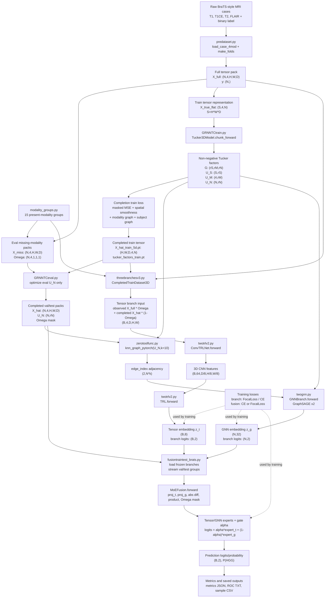

# Model Architecture

This document is based on the current code in this repository. It describes the executable pipeline for multimodal brain MRI classification with graph-regularized tensor completion, a tensor branch, a GraphSAGE branch, and a learned fusion head. It intentionally does not include hypergraph, HGNN, or HypergraphConv components because the current code does not use them in the main pipeline.

## Overall Flow

The current main workflow is script-based:

1. `predataset.py` reads BraTS-style NIfTI cases and labels, then writes full four-modality tensors and missing-modality validation/test packs.
2. `GRNNTCtrain.py` trains a graph-regularized non-negative Tucker tensor completion model on the training fold and saves train factors plus the completed training tensor.
3. `GRNNTCeval.py` completes each validation/test missing-modality pack by reusing trained spatial/modality/core Tucker factors and optimizing only the subject factor `U_N`.
4. `threebranchesv3.py` pretrains two branches:
   - `ConvTRLNet`, a 3D CNN plus tensor regression layer over completed image volumes.
   - `GNNBranch`, a GraphSAGE model over subject Tucker factors `U_N`.
5. `fusiontraintest_brats.py` freezes both branches, extracts tensor and graph embeddings, trains `MoEFusion`, and evaluates all discovered modality groups.

## Mermaid Flowchart



## Code-Level Module Summary

| Module | File | Class / Function | Real forward path? | Input | Output | Shape notes |
| --- | --- | --- | --- | --- | --- | --- |
| Data pack generation | `predataset.py` | `main`, `load_case_4mod`, `dump_eval_packs` | Yes, preprocessing path | Raw four-modality NIfTI cases and labels | `X_full_4mod.pt`, fold packs | `X_full: (N,4,H,W,D)`, `Omega: (N,4,1,1,1)` |
| Modality groups | `modality_groups.py` | `MODALITY_GROUPS`, `group_to_omega_row` | Yes, used by preprocessing, completion, branch/fusion augmentation | Present modality list | Binary mask row | 15 groups over T1/T1CE/T2/FLAIR; mask `(4,)` |
| Train tensor construction | `GRNNTCtrain.py` | `run_patient_mode` | Yes | `X_train_nm: (N,4,H,W,D)` | flattened tensor | `X_true_flat: (S,4,N)`, `S=H*W*D` |
| Tucker completion model | `GRNNTCtrain.py` | `Tucker3DModel.chunk_forward` | Yes | spatial chunk index range | reconstructed chunk | `(chunk_S,4,N)` from `G,U_S,U_M,U_N` |
| Completion train loss | `GRNNTCtrain.py` | `run_patient_mode` | Yes | `X_hat_c`, `X_true_c`, modality masks, Laplacians | scalar loss | masked MSE + spatial smoothness + modality graph + subject graph |
| Eval completion | `GRNNTCeval.py` | `Tucker3DModel.forward_flat`, `run_one` | Yes | `X_miss`, `Omega`, trained `G,U_S,U_M` | completed eval pack | optimizes eval `U_N`; saves `X_hat: (N,4,H,W,D)` |
| Train branch dataset | `threebranchesv3.py` | `CompletedTrainDataset3D.__getitem__` | Yes, branch pretraining | `X_full`, train `X_hat`, mask row | completed/observed mixed volume | `x: (4,D,H,W)` |
| Tensor branch | `twotrlv2.py` | `ConvTRLNet.forward` | Yes | image volume batch | TRL logits and embedding | input `(B,4,D,H,W)`, CNN output `(B,64,D/8,H/8,W/8)` |
| Tensor regression layer | `twotrlv2.py` | `TRL.forward` | Yes | CNN feature tensor | logits or `(logits,z_t)` | `z_t: (B,8)` with current default ranks |
| Graph construction | `zerotoolfunc.py` | `knn_graph_pytorch` | Yes | standardized `U_N` | PyG edge index | `edge_index: (2,N*k)` |
| GNN branch | `twognn.py` | `GNNBranch.forward` | Yes | `U_N` features and `edge_index` | logits and graph embedding | input `(N,rN)`, embedding `(N,32)`, logits `(N,2)` |
| Fusion model | `fusiontraintest_brats.py` | `MoEFusion.forward` | Yes | `z_t`, `z_g`, modality mask | logits and gate alpha | `z_t: (B,8)`, `z_g: (B,32)`, mask `(B,4)`, logits `(B,2)` |
| Classification loss | `threebranchesv3.py`, `fusiontraintest_brats.py`, `metrics.py` | `FocalLoss`, `CrossEntropyLoss` | Yes | logits and labels | scalar loss | branch and fusion training use CE/Focal variants |
| Metrics/reporting | `fusiontraintest_brats.py`, `metrics.py` | `eval_with_threshold`, `compute_auc_pr` | Yes, evaluation path | labels, probabilities, thresholds | metrics, CSV/JSON/TXT | includes ACC, Sensitivity, Specificity, F1, F1_macro, AUC, PR_AUC |

## Tensor Completion Details

The completion model is a non-negative Tucker factorization over a flattened 5D medical image tensor:

`X_flat in R^(S x M x N)`, where `S=H*W*D`, `M=4` modalities, and `N` subjects.

`GRNNTCtrain.py` reconstructs chunks as:

```text
X_hat_c = einsum("sa,abc,mb,nc->smn", U_S_c, G, U_M, U_N)
X_hat_c = relu(X_hat_c)
```

Training uses the true full training fold and rotates the 15 modality masks to simulate missing modalities without materializing all augmented tensors by default. The saved outputs are:

- `tucker_factors_train.pt`: `G`, `U_S`, `U_M`, `U_N`, train labels, train indices, and modality-group metadata.
- `X_hat_train_5d.pt`: completed train tensor shaped `(H,W,D,4,N)`.

`GRNNTCeval.py` reuses the trained `G`, `U_S`, and `U_M`, initializes a new eval `U_N`, and optimizes only `U_N` for each validation/test missing-modality pack. Observed entries are copied back into the completed tensor before saving, so observed modalities remain unchanged in the completed pack.

## Graph Neural Network Details

The graph branch uses subject factors `U_N` from tensor completion as node features. `zerotoolfunc.knn_graph_pytorch` builds a KNN graph from standardized `U_N`, returning PyTorch Geometric `edge_index`.

`twognn.GNNBranch` is the active GNN module. It applies:

```text
MLP(U_N) -> SAGEConv -> LayerNorm/ReLU -> SAGEConv -> LayerNorm/ReLU -> Dropout -> Linear classifier
```

The current fusion script freezes the trained GNN branch and uses the returned hidden embedding `z_g`, not only the branch classifier logits.

## Feature Fusion Details

The active fusion module is `fusiontraintest_brats.MoEFusion`, not `twognn.FusionNet`.

`MoEFusion.forward` projects tensor and graph embeddings to a shared hidden dimension, concatenates:

```text
[projected tensor, projected graph, abs difference, elementwise product, modality mask]
```

Then a scalar gate `alpha` mixes two expert classifiers:

```text
logits = alpha * expert_t(ft) + (1 - alpha) * expert_g(fg)
```

The final probability is computed with softmax over the two logits; class `1` is treated as HGG in the current binary task.

## Defined But Not Used In The Main Flow

These components exist in the repository but are not drawn in the main flowchart because they are not part of the current executable tensor-completion + GNN fusion pipeline:

- `twognn.GateFusion` and `twognn.FusionNet`: defined, but `fusiontraintest_brats.py` uses `MoEFusion` instead.
- `dataset.BrainTumor3DDataset` and `train.Tiny3DCNN`: older standalone CNN baseline path.
- `resnet2025.py`, `CP.py`, `KNN.py`, `casemean.py`, `maskchannel.py`, `moddrop.py`: baseline or exploratory scripts, not called by the current main pipeline.
- `zerotoolfunc.build_tensor_features`: utility function present, but not used in the current main fusion path.
- `GRNNTCtrain.run_augmented_mode`: available, but current pack generation and recommended runs default to patient mode unless materialized augmented train packs are explicitly used.

## Limitations Of This Diagram

- The codebase is script-oriented rather than a single package with one central `Model` class, so the diagram shows the end-to-end experiment pipeline rather than one monolithic `forward`.
- Tensor completion training/evaluation happens before branch and fusion training; it is not called inside `MoEFusion.forward`.
- Shapes are based on current code conventions. Actual `H,W,D`, ranks, and batch sizes are configurable through environment variables and generated pack metadata.
- The diagram excludes post-hoc calibration and sweep scripts because they operate on saved predictions rather than participating in model forward or loss computation.
- No hypergraph modules are included because the current code search found no actual HGNN/HypergraphConv implementation in the main path.

## Consistency Check

- Every module in the Mermaid and DOT files exists in the current codebase.
- Every solid arrow represents a data dependency used by preprocessing, tensor completion, branch pretraining, embedding extraction, fusion training, or evaluation.
- Hypergraph-related modules were not included. Text search only found ordinary comments containing the word `Hyperparams`, not hypergraph methods.
- Tensor completion and GraphSAGE are both included because they are central to the current pipeline.
- Defined but unused baseline or exploratory modules are listed separately and are not drawn in the main flow.
